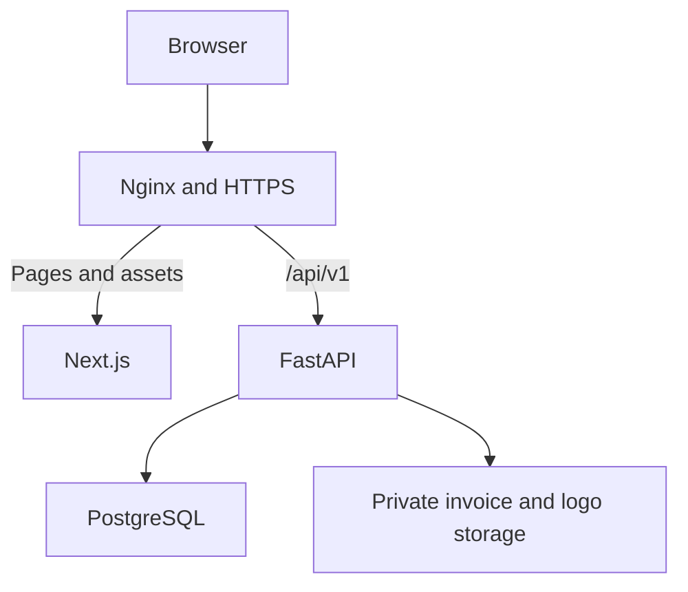

# Stock Management Dashboard

> Project requirements and implementation plan.
> Status: proposed specification awaiting client clarification.
> Stack: Next.js + FastAPI + PostgreSQL.

## 1. Project overview

Build a web application that helps a business manage:

- Products, categories, stock quantities, and storage locations.
- Incoming purchases and purchase prices.
- Sales and printable invoices.
- Money owed by customers.
- Money owed to suppliers.
- Customer purchase and payment history.
- Low-stock alerts.

The application should let the owner answer:

1. What products do I have, how many, and where?
2. When did I receive them, from whom, and at what price?
3. What did I sell, to whom, and for how much?
4. Which customers still owe me money?
5. Which suppliers do I still need to pay?

### Requirement labels

- **[Requested]**: directly expressed in the client's notes.
- **[Proposed]**: recommended addition needed for a practical implementation.
- **[Confirm]**: interpretation or business rule to confirm with the client.
- **[Later]**: optional feature outside the initial release.

## 2. Translation and clarification of the original notes

| Original note | English interpretation | Implementation |
|---|---|---|
| sl3a fin kyna | Where the goods are located | Track stock by physical location. **[Confirm]** Whether this means a shop, warehouse, shelf, or just product availability. |
| imta dkhlat | When the goods arrived | Record the received date for every purchase receipt. |
| bch7al dkhlat | How much the goods cost | Store the purchase unit price on each purchase line. **[Confirm]** Whether the client also meant received quantity; the system will track both. |
| bch7al khasha tba3 | How much the goods should sell for | Store a default selling price per product. |
| w achmn category | Which category the goods belong to | Assign a category to each product. |
| mnin tkhrj tkhrj facture | Generate an invoice when goods leave | Issue an invoice when a sale is confirmed. **[Confirm]** Whether delivery and invoicing can happen separately. |
| notify ila 9rbat tsali chi sl3a | Notify when a product is nearly out of stock | Configure low-stock thresholds and show alerts. |
| credit m3a les clients | Customer credit | Track customer unpaid balances and payments received. |
| ch7al katsalo | How much the customer owes | Calculate the outstanding balance. |
| ch7al 3ta avance w date dyalo | How much was paid in advance and when | Record each payment amount and date. |
| imta aykhls | When the customer will pay | Record a payment due date. |
| credit m3a les fournisseurs | Supplier credit | Track unpaid purchase balances and payments made. |
| ch7al dyal sl3a dkhlat | How much stock was received | Record purchase quantities. |
| les produits li dkhlo w bch7al w imta | Products received, their prices, and arrival dates | Maintain purchase history by supplier and product. |
| client tracking by full name | Find customers and inspect their history | Search by name and show purchases, payments, and outstanding balances. |

**Terminology:** “credit” means an unpaid balance in this specification.
Customer credit is money the business is owed; supplier credit is money
the business owes.

## 3. Proposed initial scope

These assumptions keep the first release manageable:

| Area | Proposed default |
|---|---|
| Business | One company using the application internally |
| Users | Owner and employees; no customer login |
| Currency | One currency; MAD if confirmed |
| Locations | Stock stored per location, starting with one default location |
| Quantities | Whole units unless fractional sales are required |
| Sales | Confirming a sale issues its invoice and removes stock |
| Purchases | Confirming a purchase records receipt and supplier debt together |
| Payments | Full or partial payments against confirmed documents |
| Credit terms | One due date per unpaid sale or purchase |
| Stock | Negative stock is blocked |
| Notifications | In-app low-stock alerts |
| Connectivity | Online application; offline mode excluded initially |

**[Confirm]** If supplier invoices arrive separately from goods, or deliveries
happen separately from sales invoices, introduce separate receipt, delivery,
and invoice documents before implementing those workflows.

## 4. Functional requirements

### 4.1 Products and categories

**[Requested]**

Each product must have:

- Name.
- Category.
- Default selling price.
- Current stock quantity and location.
- Purchase history showing received quantities, dates, and costs.

**[Proposed]**

Also store:

- Unique SKU: an internal product reference.
- Unit of measure: piece, kilogram, meter, etc.
- Low-stock threshold.
- Active/inactive status.
- Optional description and barcode.

Business rules:

- Product names do not have to be unique; SKUs do.
- Archive products used in historical transactions instead of deleting them.
- Editing the default selling price must not alter existing invoices.
- Purchase prices belong to purchase lines because costs can change between deliveries.
- Show “latest purchase price” as a convenience, not as the complete cost history.

### 4.2 Inventory and storage locations

**[Requested]**

Users must be able to:

- See available quantities.
- Find where products are stored.
- Inspect when goods arrived.
- Filter products by category, location, and stock status.

**[Proposed]**

Track every stock change as a movement:

| Movement | Quantity effect | Source |
|---|---:|---|
| Opening stock | Increase | Initial import |
| Purchase receipt | Increase | Confirmed purchase |
| Sale | Decrease | Confirmed sale |
| Adjustment | Increase or decrease | Count correction, loss, damage |
| Transfer | Decrease at source, increase at destination | Location transfer |
| Reversal | Opposite of original movement | Approved correction |

Rules:

- Users cannot directly overwrite a stock balance.
- Corrections require an adjustment with a reason and responsible user.
- Draft sales and purchases do not change stock.
- For the MVP, drafts do not reserve stock either.
- Transfer between locations does not create a sales invoice.
- Damage or loss does not create a sales invoice.
- Restrict manual adjustments to authorized roles.

The movement ledger explains stock history.
A stock-balance table can provide fast current quantities.
Both must be updated in the same database transaction.

### 4.3 Purchases and supplier balances

**[Requested]**

A purchase records:

- Supplier.
- Receipt date.
- Products and quantities.
- Purchase unit price for each product.
- Total purchase amount.
- Amount paid.
- Remaining balance.

**[Proposed]**

Also record:

- Internal purchase number.
- Supplier invoice reference, if available.
- Payment due date.
- Receiving location.
- Notes and the employee who recorded the purchase.

Workflow:

1. Select or create the supplier.
2. Add products, quantities, prices, and receiving location.
3. Review the calculated total.
4. Confirm receipt.
5. Increase stock and create the supplier payable.
6. Record an immediate payment, if any.
7. Record later payments against the remaining balance.

A supplier profile must show purchases, payment history, total owed,
and overdue purchases.

**[Confirm]** Payments made before goods are received require a separate
supplier-advance workflow. The initial default supports payment at receipt
or afterward.

### 4.4 Sales and customer invoices

**[Requested]**

The invoice must include:

- Company name and logo.
- Date goods were sold/dispatched.
- Customer name.
- Product names.
- Quantity per product.
- Selling unit price.
- Line totals.
- Total amount.
- Amount paid and remaining credit.

**[Proposed]**

Also include:

- Unique invoice number.
- Issue date, if different from dispatch date.
- Currency.
- Payment due date when applicable.
- Company and customer contact details.
- Applicable tax/discount information after client confirmation.

Workflow:

1. Select or create a customer.
2. Add products and quantities.
3. Load default selling prices.
4. Allow authorized price changes, if approved by the owner.
5. Validate available stock.
6. Confirm the sale.
7. Atomically reduce stock and issue the invoice.
8. Record the initial payment, if any.
9. Make the invoice available for viewing, printing, and PDF download.

Rules:

- Invoice issuance does not depend on full payment.
- Stock leaves once when the sale is confirmed.
- Later payments never change stock.
- Generating or downloading the PDF again never changes stock.
- The backend calculates authoritative prices and totals.
- Invoice lines preserve product descriptions and prices at issuance.
- Company/customer details shown on issued invoices are historical snapshots.
- Later edits to customer names, product names, or company settings must
  not rewrite issued invoices.

Preserve the original issued invoice. Subsequent payments appear in payment
receipts and a current account statement or clearly dated balance view.

**[Confirm]** Obtain a sample invoice and the client's required fields,
numbering, taxes, and rounding rules before finalizing the invoice template.

### 4.5 Customer credit and payments

**[Requested]**

For each customer, show:

- Total amount owed.
- Amount already paid.
- Each payment amount and date.
- Expected payment date.
- Outstanding invoices.

**[Proposed]**

Each payment records:

- Customer.
- Amount.
- Payment date.
- Method: cash, transfer, cheque, or other.
- Optional reference.
- Employee who recorded it.
- Invoice allocation.

For the initial release, record a payment against one invoice.
If a customer pays several invoices together, the UI can split the amount
into explicit allocations.

Rules:

- Do not store customer debt as a manually editable profile field.
- Calculate debt from confirmed invoices and valid payment allocations.
- Reject payments exceeding the invoice balance in the initial release.
- A payment changes the balance without changing the invoice's original total.
- Keep payment history; corrections use linked reversals.
- Do not offset customer receivables against supplier payables automatically.

**[Confirm]** “Avance” is initially interpreted as a partial payment at the
time of sale. Deposits before any invoice exists require an unallocated
customer-credit workflow.

### 4.6 Customer search and history

**[Requested]**

Search customers by full name and inspect:

- Products purchased.
- Quantities and prices.
- Purchase dates.
- Invoices.
- Payments.
- Remaining debt.

**[Proposed]**

Customer fields:

- Internal ID.
- Full name or business name.
- Optional phone, address, and notes.

Rules:

- Full names are searchable but are not unique identifiers.
- Two customers can have the same name.
- Display phone or customer reference to distinguish matches.
- Support case-insensitive partial-name search.
- Paginate histories and allow filtering by date and payment status.

### 4.7 Low-stock alerts

**[Requested]**

Notify users when a product is nearly out of stock.

**[Proposed]**

- Configure a threshold per product and location.
- Mark stock as low when quantity is less than or equal to the threshold.
- Show active alerts on the dashboard and stock list.
- Resolve the alert when stock rises above the threshold.
- Maintain one active alert per product/location to avoid duplicates.
- Acknowledging an alert does not change stock.

Start with in-app alerts updated after stock operations and on dashboard refresh.

**[Later]** Email, WhatsApp, or SMS delivery.

### 4.8 Dashboard and permissions

**[Proposed]**

Dashboard cards:

- Confirmed sales total for the selected period.
- Customer payments received during the period.
- Outstanding customer balances.
- Outstanding supplier balances.
- Overdue amounts.
- Number of low-stock products.

Sales revenue and cash received are different metrics.
Do not label either one as profit.

Suggested roles:

| Action | Owner | Sales employee | Stock employee |
|---|---|---|---|
| Manage users and company settings | Yes | No | No |
| Manage products | Yes | Read | Yes |
| Confirm sales and receive customer payments | Yes | Yes | No |
| Receive purchases | Yes | No | Yes |
| Record supplier payments | Yes | No | No |
| Adjust stock or reverse transactions | Yes | No | No |
| View purchase costs and all financial reports | Yes | Confirm | Confirm |

Enforce permissions in FastAPI, including restrictions on sensitive fields.

## 5. Business rules and calculations

### Amounts

For the initial version without discounts or taxes:

```text
line_total = quantity × unit_price
document_total = sum(line_totals)
remaining_balance = document_total − valid_allocated_payments
```

Use Python Decimal and PostgreSQL NUMERIC for money.
Send monetary values as decimal strings in API payloads.

Agree on rounding before implementation, including whether rounding happens
per line and how fractional quantities are handled.

### Payment status

Keep document status separate from payment status.

```text
Document: DRAFT → CONFIRMED → REVERSED

Payment:
UNPAID          paid = 0 and total > 0
PARTIALLY_PAID   0 < paid < total
PAID            paid = total

Overdue:
remaining_balance > 0 AND due_date < business_today
```

Overdue is a derived condition. An invoice can be both partially paid
and overdue.

### Transaction integrity

When confirming a sale:

1. Begin a database transaction.
2. Lock the draft sale.
3. Check its status and the request's idempotency key.
4. Lock affected product/location stock rows in a consistent order.
5. Recheck stock and calculate totals.
6. Create the invoice snapshots and stock movements.
7. Update stock balances.
8. Record any initial payment and allocation.
9. Commit all changes together.

If a step fails, roll back the entire operation.

Use database uniqueness constraints to prevent duplicate invoice numbers,
duplicate posting of a document, and duplicate idempotency keys.

A repeated request with the same idempotency key and same input must return
the original outcome. Reusing a key with different input must be rejected.

Generate the PDF after committing the sale. If PDF rendering fails, allow
retrying it without confirming the sale again.

### Corrections and returns

- Drafts are editable.
- Confirmed records are not silently edited or deleted.
- Owner corrections create linked reversal records with a reason.
- A reversal can only happen once.
- Reverse allocated payments before reversing the associated document.
- Reversing a purchase must not make stock negative.

**[Confirm]** Full reversal is for correcting an erroneous transaction.
Actual customer returns may involve partial quantities, damaged goods,
refunds, or credit notes. If returns occur in normal business, define and
implement that workflow before launch.

## 6. Recommended technology stack

| Layer | Choice | Purpose |
|---|---|---|
| Frontend | Next.js + TypeScript | Dashboard pages, forms, routing |
| Styling | Tailwind CSS | Consistent responsive interface |
| Backend | FastAPI + Pydantic | API, validation, authentication, business rules |
| Database | PostgreSQL | Relational data and transactional consistency |
| ORM | SQLAlchemy | Models and database queries |
| Migrations | Alembic | Versioned schema changes |
| Database driver | Psycopg | PostgreSQL access |
| Invoice rendering | Server-generated HTML/PDF | Consistent printable documents |
| Deployment | Docker Compose + Nginx | Application services and HTTPS routing |
| Backend tests | pytest | Financial and inventory rules |
| Browser tests | Playwright | Main user workflows |

### Why this stack?

Next.js suits an interactive dashboard, and FastAPI provides a clear API
boundary for business logic. PostgreSQL fits the relationships between
products, customers, invoices, and payments.

The main costs are:

- Two runtimes and deployment services.
- Maintaining the frontend/backend API contract.
- Implementing administration, permissions, and reporting screens.
- Handling database transactions and invoice rules explicitly.

These are manageable tradeoffs for this project.

Generate TypeScript API types from FastAPI's OpenAPI schema to reduce
contract mismatches.

A practical starting point is synchronous SQLAlchemy with regular `def`
FastAPI routes. If adopting async database access, use it consistently;
calling blocking database operations directly inside `async def` can block
the event loop.

Select compatible supported package versions at project setup and pin them
in lockfiles.

Redis, task queues, and WebSockets are optional future additions.
The initial workflows can use ordinary HTTP requests.

## 7. Application architecture

Use a modular monolith: one backend application organized by business area.



Recommended public routing:

- `/` serves Next.js.
- `/api/v1/` serves FastAPI under the same origin.
- PostgreSQL is accessible only on the private application network.

Keep stock calculations, payment rules, permissions, and invoice creation
inside FastAPI. Next.js should not write directly to the database.

Backend request flow:

1. Router validates the request and identifies the user.
2. Service applies permissions and business rules.
3. SQLAlchemy reads/writes within the required transaction.
4. Response schema returns only permitted fields.

Avoid a separate microservice for each module.

### Authentication

For this internal browser application, a practical default is:

- Backend-managed sessions.
- Random session token in an HttpOnly, Secure cookie.
- Session expiry and server-side logout/revocation.
- CSRF protection for state-changing requests.
- Password hashing and login rate limiting.
- No public registration; the owner creates employee accounts.

Same-origin routing simplifies browser integration.
Local development may require an explicit CORS allowlist if ports differ.

## 8. Suggested database model

All operational records should include relevant creation timestamps and
responsible user IDs.

| Table | Important fields |
|---|---|
| users | id, username, password_hash, role, is_active |
| sessions | id, user_id, token_hash, expires_at, revoked_at |
| company_settings | name, logo_reference, contact_details, currency, timezone |
| categories | id, name |
| products | id, sku, name, category_id, unit, default_sale_price, is_active |
| locations | id, name, description |
| stock_balances | product_id, location_id, quantity, low_stock_threshold |
| customers | id, full_name, phone, address, notes |
| suppliers | id, name, phone, address, notes |
| purchases | id, number, supplier_id, status, received_at, due_date, total |
| purchase_items | id, purchase_id, product_id, location_id, quantity, unit_cost |
| sales | id, customer_id, status, sold_at, due_date, total |
| sale_items | id, sale_id, product_id, location_id, quantity, unit_price, line_total |
| invoices | id, sale_id, number, issued_at, company_snapshot, customer_snapshot, document_snapshot |
| stock_movements | id, product_id, location_id, signed_quantity, type, source_line_id, reason, reversal_of_id |
| customer_payments | id, customer_id, amount, paid_at, method, reference, reversal_of_id |
| customer_payment_allocations | payment_id, sale_id, amount |
| supplier_payments | id, supplier_id, amount, paid_at, method, reference, reversal_of_id |
| supplier_payment_allocations | payment_id, purchase_id, amount |
| audit_events | id, actor_id, action, entity_type, entity_id, timestamp, details |
| idempotency_records | actor_id, operation, key, request_hash, result_reference |

Implementation notes:

- Unique stock balance per `(product_id, location_id)`.
- Unique invoice number and one invoice per confirmed sale in the initial model.
- Use explicit foreign keys for movement sources where practical; avoid
  unvalidated references.
- Positive quantities and nonnegative prices on document lines.
- Signed quantities only in the stock-movement ledger.
- Allocations must belong to the same customer/supplier as their payment.
- Allocation totals cannot exceed the payment or the target document balance.
- Lock affected records when allocating simultaneous payments.
- Index SKUs, customer names, document dates, due dates, and foreign keys.
- Store timestamps with timezone; store payment deadlines as business dates.

Do not store one `debt` field on a customer or one `purchase_price` on a product
as the complete source of truth.

## 9. Initial API outline

All routes below require authentication and appropriate permissions.

| Area | Example endpoints |
|---|---|
| Authentication | `POST /auth/login`, `POST /auth/logout`, `GET /auth/me` |
| Products | `GET/POST /products`, `GET/PATCH /products/{id}` |
| Categories | `GET/POST /categories` |
| Locations | `GET/POST /locations` |
| Inventory | `GET /stock`, `GET /stock/movements`, `POST /stock/adjustments` |
| Customers | `GET/POST /customers`, `GET/PATCH /customers/{id}` |
| Customer history | `GET /customers/{id}/statement` |
| Suppliers | `GET/POST /suppliers`, `GET /suppliers/{id}/statement` |
| Purchases | `POST /purchases`, `PATCH /purchases/{id}`, `POST /purchases/{id}/confirm` |
| Sales | `POST /sales`, `PATCH /sales/{id}`, `POST /sales/{id}/confirm` |
| Invoices | `GET /invoices/{id}`, `GET /invoices/{id}/pdf` |
| Customer payments | `POST /customer-payments` |
| Supplier payments | `POST /supplier-payments` |
| Corrections | `POST /sales/{id}/reverse`, `POST /purchases/{id}/reverse` |
| Payment corrections | `POST /customer-payments/{id}/reverse`, `POST /supplier-payments/{id}/reverse` |
| Dashboard | `GET /dashboard/summary`, `GET /alerts/low-stock` |

Prefix these routes with `/api/v1`.

List endpoints need pagination and relevant search/filter parameters.
Use `409 Conflict` for insufficient stock or conflicting document state,
`422` for invalid input, and `403` for insufficient permission.

Require idempotency keys for confirmation and payment operations.

## 10. Frontend pages

1. Login.
2. Dashboard.
3. Products and categories.
4. Stock by location and movement history.
5. Purchases and purchase creation.
6. Sales and sale creation.
7. Invoice preview and download.
8. Customers and customer details.
9. Suppliers and supplier details.
10. Customer receivables.
11. Supplier payables.
12. Company settings and user management.

Customer details should group:

- Contact information.
- Outstanding balance.
- Sales history.
- Payment history.
- Overdue invoices.

Use visible labels and confirmation summaries before posting a sale,
purchase, payment, or stock correction.

## 11. Suggested project organization

| Path | Responsibility |
|---|---|
| `frontend/src/app/` | Next.js pages and layouts |
| `frontend/src/features/` | Product, sales, purchase, and customer interfaces |
| `frontend/src/components/` | Shared UI components |
| `frontend/src/lib/` | API client, formatting, generated types |
| `backend/app/main.py` | FastAPI application setup |
| `backend/app/core/` | Settings, authentication, permissions |
| `backend/app/db/` | Database engine and session management |
| `backend/app/modules/` | Catalog, inventory, purchases, sales, payments, reports |
| `backend/app/templates/` | Invoice templates |
| `backend/alembic/` | Database migrations |
| `backend/tests/` | Business rule and integration tests |
| `nginx/` | Reverse proxy configuration |
| `compose.yaml` | Local and deployment services |
| `.env.example` | Documented configuration without secrets |
| `README.md` | Requirements and setup documentation |

Within each backend module, start with `router.py`, `schemas.py`,
`models.py`, and `service.py` where needed. Keep the structure small.

## 12. Development workflow and milestones

### Phase 1 — Confirm the business process

- Review the questions in section 15.
- Collect a sample invoice and examples of real purchases and payments.
- Confirm units, locations, currency, taxes, and permissions.
- Agree on initial scope.
- Sketch the purchase, sale, and customer-profile screens.

**Deliverable:** approved workflows and invoice example.

### Phase 2 — Foundation

- Create the Next.js and FastAPI applications.
- Configure PostgreSQL and migrations.
- Implement login, sessions, and permissions.
- Add company settings, categories, products, and locations.

**Deliverable:** users can sign in and maintain the product catalog.

### Phase 3 — Purchasing and inventory

- Add suppliers and purchase drafts.
- Implement purchase confirmation.
- Add stock balances, movements, and opening-stock import.
- Add supplier payments.

**Deliverable:** receiving goods updates stock and supplier debt correctly.

### Phase 4 — Sales and customer credit

- Add customers and sales drafts.
- Implement atomic sale confirmation.
- Generate invoices.
- Add customer payments and statements.

**Deliverable:** one complete purchase → sale → partial payment workflow.

### Phase 5 — Operational readiness

- Add low-stock alerts and dashboard summaries.
- Add corrections and audit history.
- Implement required returns, taxes, or delivery separation.
- Test concurrency and duplicate requests.

**Deliverable:** agreed business scenarios pass.

### Phase 6 — Client pilot and deployment

- Deploy a staging version.
- Let the client test realistic transactions.
- Import and reconcile opening stock and opening debts.
- Configure backups and verify restoration.
- Provide a short operating guide.
- Launch after reconciling stock and balances.

Build and demonstrate one complete workflow at a time.
Prioritize transaction correctness before decorative dashboard charts.

## 13. Acceptance tests

| Scenario | Expected result |
|---|---|
| Receive 10 units at 50 MAD and pay supplier 200 MAD | Stock +10; purchase total 500; supplier balance 300 |
| Sell 3 units at 80 MAD and receive 100 MAD | Stock −3; sale total 240; customer balance 140 |
| Receive remaining customer payment of 140 MAD | Invoice paid; stock unchanged |
| Change product name and default price | Previously issued invoice remains unchanged |
| Request invoice PDF twice | No additional stock movement or invoice |
| Retry sale confirmation after network failure | Original sale result returned; no duplicate posting |
| Two users sell the final unit concurrently | Only one sale succeeds |
| Two users record payments against the same remaining balance | No over-allocation |
| Stock reaches threshold | One active low-stock alert |
| Replenish above threshold | Alert resolves |
| Search two customers with the same name | Separate records remain distinguishable |
| Employee attempts unauthorized stock adjustment | Backend rejects the request |
| Database error occurs during sale confirmation | Invoice, stock, and initial payment all roll back |

Use PostgreSQL for transaction/concurrency integration tests.
SQLite does not reproduce all PostgreSQL locking behavior.

## 14. Deployment and maintenance

Start with a single deployment running:

- Nginx.
- Next.js.
- FastAPI.
- PostgreSQL.

Operational requirements:

- HTTPS.
- Private database networking.
- Persistent database and document storage.
- Secrets outside source control.
- Automated database and document backups.
- A tested restore procedure.
- Database migrations run as a controlled release step.
- Error logs and application health checks.

Agree with the client on acceptable downtime and data loss.
Backup frequency must match those expectations.

At cutover, import existing stock and unpaid customer/supplier balances
using explicit opening records. Do not create fake new sales or purchases
just to represent historical debt.

## 15. Questions to confirm with the client

### Resolve before database and workflow implementation

1. What products are sold? Pieces, kilograms, meters, cartons, or mixed units?
2. Does “where the goods are” mean multiple shops, warehouses, or shelves?
3. Does confirming a sale always mean immediate delivery?
4. Do goods and supplier invoices always arrive together?
5. Does “avance” include deposits paid before an invoice or delivery exists?
6. Are customer returns, supplier returns, or refunds common?
7. Are there existing stock quantities and unpaid balances to import?

### Resolve before completing the interface and invoices

8. Should the interface and invoices use Arabic, French, English, or several languages?
9. Is MAD the only currency?
10. Which invoice fields, tax rules, discounts, and numbering are required?
11. Can employees change selling prices or see purchase costs?
12. Can one payment settle several invoices?
13. Is one payment due date sufficient, or are installment schedules needed?
14. Are walk-in sales allowed without identifying a customer?
15. Are in-app alerts enough?
16. Must the application work without internet?
17. Are barcode scanners, batch numbers, expiry dates, or serial numbers needed?

Until answered, the defaults in this document are proposals rather than
confirmed client requirements.

## 16. Possible later features

- Barcode scanning.
- Quotations and purchase orders.
- Separate deliveries and invoices.
- Installment schedules and unallocated deposits.
- Email or WhatsApp reminders.
- Batch and expiry-date tracking.
- Multi-company support.
- Offline operation and synchronization.
- Accounting integrations.
- Profit and inventory valuation reports after agreeing on a costing method.

Move any of these into the initial scope if the client needs them for
normal daily operations.

## 17. Technical references

These references support implementation choices; the business workflows
above are project-specific proposals.

- Next.js with an existing backend:
  https://nextjs.org/docs/app/guides/custom-server
- FastAPI database integration:
  https://fastapi.tiangolo.com/tutorial/sql-databases/
- FastAPI synchronous and asynchronous route behavior:
  https://fastapi.tiangolo.com/async/
- PostgreSQL exact numeric types:
  https://www.postgresql.org/docs/current/datatype-numeric.html
- PostgreSQL row locking:
  https://www.postgresql.org/docs/current/sql-select.html
- SQLAlchemy transaction management:
  https://docs.sqlalchemy.org/en/20/orm/session_transaction.html